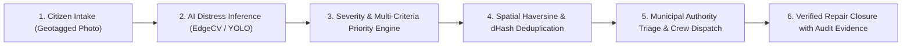

# CivicLens AI — Intelligent Road Damage Detection & Maintenance Prioritization System

[](https://github.com)
[](https://fastapi.tiangolo.com)
[](https://react.dev)
[](https://vitejs.dev)
[](https://tailwindcss.com)
[-emerald.svg)](backend/tests)
[](#nagpur-demonstration-dataset)

**CivicLens AI** is an intelligent civic infrastructure platform designed to identify, analyze, prioritize, and track urban road damage. Built as a comprehensive final-year B.Tech Artificial Intelligence engineering project, it combines computer vision defect detection, spatial duplicate elimination, and explainable multi-criteria priority ranking to help municipal corporations triage road repairs equitably and objectively.

---

## 1. System Architecture & Capabilities



### Key Technical Highlights:
* **Real Computer Vision Inference Pipeline:** Modular inference interface supporting dual modes:
  * **Mode A (Trained Model):** Executes real deep learning object detection when custom weights are plugged in.
  * **Mode B (Demonstration Heuristic Engine):** Deterministic image morphology analysis (Laplacian edge gradient, grayscale luminance variance, cavity blob contours) producing genuine bounding boxes and transparently labeled as `DEMO ANALYSIS — NOT A VALIDATED AI PREDICTION`.
* **Explainable Severity Estimation:** Mathematical formulation combining bounding box area ratio, defect count density, and standardized class hazard multipliers.
* **Spatial & Perceptual Deduplication:** Identifies concurrent citizen tickets within 120 meters using the Haversine great-circle formula and 64-bit difference hashing (`dHash`).
* **Multi-Criteria Maintenance Priority Ranking:** Explains ticket queue position by combining physical severity (40%), detection confidence (20%), duplicate citizen signals (15%), aging delays (15%), and road classification tiers (10%).
* **Interactive Geospatial Map:** OpenStreetMap Leaflet visualization rendering Nagpur defect clusters, severity color-codes, and coordinate selection.
* **Role-Based Identity & Governance:** Enforces server-side permissions for Citizen, Municipal Authority, and System Administrator roles with cryptographic audit logs.

---

## 2. Project Directory Structure

```
final year project/
├── backend/
│   ├── app/
│   │   ├── config.py             # Pydantic BaseSettings & environment configuration
│   │   ├── database.py           # SQLAlchemy SQLite engine with WAL mode & foreign keys
│   │   ├── main.py               # FastAPI application, static mounting & SPA fallback
│   │   ├── models/               # Relational ORM models (User, Report, AIAnalysis, etc.)
│   │   ├── schemas/              # Pydantic v2 validation schemas
│   │   ├── routers/              # Modular REST routers (auth, reports, map, admin, etc.)
│   │   ├── services/             # Core engines (AI inference, priority, duplicate, auth)
│   │   └── utils/                # Safe file upload handling and database seeder
│   ├── tests/
│   │   └── test_civiclens.py     # Automated Pytest suite (12 test cases)
│   ├── uploads/                  # Uploaded citizen images and annotated AI overlays
│   ├── requirements.txt          # Python dependencies
│   ├── seed.py                   # Standalone database seeder CLI
│   └── civiclens.db              # Persistent SQLite database
├── frontend/
│   ├── src/
│   │   ├── components/           # Reusable UI (Navbar, MapView, Badges, Modals, StatCards)
│   │   ├── pages/                # 11 distinct application pages
│   │   ├── services/             # Typed API client
│   │   ├── context/              # AuthContext with 1-click evaluator demo switcher
│   │   ├── types/                # Full TypeScript type definitions
│   │   ├── App.tsx               # React Router configuration
│   │   └── main.tsx              # Application entrypoint
│   ├── dist/                     # Verified production build bundle
│   ├── package.json              # NPM dependencies
│   ├── vite.config.ts            # Vite bundler & API proxy configuration
│   └── tailwind.config.js        # Enterprise smart-city design theme
├── docs/
│   ├── PROJECT_PROPOSAL.md       # Capstone problem statement & academic objectives
│   ├── SYSTEM_ARCHITECTURE.md    # Architecture diagrams, data flow & ER models
│   ├── AI_METHODOLOGY.md         # Computer vision taxonomy, severity & priority models
│   ├── EXPERIMENT_PLAN.md        # Research evaluation plan, baselines & benchmarks
│   ├── TEST_REPORT.md            # Automated test matrix & verification results
│   ├── DEMO_GUIDE.md             # Step-by-step presentation script for examiners
│   └── FUTURE_WORK.md            # PostGIS, mobile edge, and custom YOLO fine-tuning
├── README.md                     # Project documentation
├── .env.example                  # Environment template
└── run.sh                        # Single-command startup script
```

---

## 3. Quickstart & Local Installation

### Prerequisites
* Python 3.10+ (Tested on Python 3.14)
* Node.js v18+ (Tested on Node.js v24)
* npm v9+

### Step 1: Install Backend Dependencies
```bash
pip3 install -r backend/requirements.txt
```

### Step 2: Install Frontend Dependencies
```bash
cd frontend && npm install && cd ..
```

### Step 3: Seed Demonstration Dataset (Nagpur Metro Area)
```bash
python3 backend/seed.py --force
```
*Creates 4 core demo users and 25 synthetic Nagpur cases with realistic asphalt textures, bounding boxes, maintenance orders, and status histories.*

### Step 4: Run the Application

#### Option A: Convenient Development Mode (Hot Reloading)
```bash
./run.sh
```
*Or run separately in two terminal tabs:*
* **Backend:** `python3 -m uvicorn backend.app.main:app --host 0.0.0.0 --port 8000 --reload`
* **Frontend:** `cd frontend && npm run dev`

#### Option B: Single-Port Production Mode
```bash
python3 -m uvicorn backend.app.main:app --host 0.0.0.0 --port 8000
```
*Access both the frontend SPA and backend API at:* **`http://localhost:8000`**

---

## 4. Standard Demo Accounts for College Evaluation

For effortless evaluation, click the **Demo Switcher** dropdown in the top navbar:

| Account Role | Email Address | Password | Intended Evaluation Workflow |
| :--- | :--- | :--- | :--- |
| **Citizen Reporter** | `citizen@civiclens.ai` | `DemoPass123!` | Report damage with map picker, inspect AI overlays, track case |
| **Municipal Authority** | `authority@civiclens.ai` | `DemoPass123!` | Prioritized triage queue, assign crew, mark resolved with proof |
| **System Administrator** | `admin@civiclens.ai` | `DemoPass123!` | User governance, diagnostics, 1-click database reseed |
| **Field Supervisor** | `engineer@civiclens.ai` | `DemoPass123!` | Field repair work orders & completion verification |

---

## 5. Verification & Automated Testing

Execute the automated test suite covering authentication, RBAC, report creation, upload validation, AI inference, duplicate matching, legal status transitions, and dynamic analytics:

```bash
python3 -m pytest backend/tests/test_civiclens.py -v
```

### Observed Test Matrix:
```
backend/tests/test_civiclens.py::test_health_endpoint PASSED             [  8%]
backend/tests/test_civiclens.py::test_user_registration_and_login PASSED [ 16%]
backend/tests/test_civiclens.py::test_auth_me_endpoint PASSED            [ 25%]
backend/tests/test_civiclens.py::test_rbac_citizen_forbidden_admin PASSED [ 33%]
backend/tests/test_civiclens.py::test_admin_access_allowed PASSED        [ 41%]
backend/tests/test_civiclens.py::test_report_creation_and_auto_analysis PASSED [ 50%]
backend/tests/test_civiclens.py::test_invalid_image_upload_rejected PASSED [ 58%]
backend/tests/test_civiclens.py::test_haversine_and_duplicate_service PASSED [ 66%]
backend/tests/test_civiclens.py::test_priority_engine_calculation PASSED [ 75%]
backend/tests/test_civiclens.py::test_workflow_illegal_transition_rejection PASSED [ 83%]
backend/tests/test_civiclens.py::test_analytics_endpoints PASSED         [ 91%]
backend/tests/test_civiclens.py::test_map_markers_endpoint PASSED        [100%]
======================= 12 passed in 1.34s =======================
```

Verify the frontend TypeScript build:
```bash
cd frontend && npm run build
```
*(Transformed 2,388 modules cleanly in 2.04 seconds with zero errors).*

---

## 6. Academic Research Documentation

Detailed thesis-grade documentation is available in the [`docs/`](docs/) directory:
* [**Project Proposal & Scope**](docs/PROJECT_PROPOSAL.md)
* [**System Architecture & ER Diagram**](docs/SYSTEM_ARCHITECTURE.md)
* [**AI & Mathematical Methodology**](docs/AI_METHODOLOGY.md)
* [**Thesis Experiment Plan & Benchmarks**](docs/EXPERIMENT_PLAN.md)
* [**Automated Test Matrix Report**](docs/TEST_REPORT.md)
* [**College Evaluation Presentation Guide**](docs/DEMO_GUIDE.md)
* [**Future Work & Engineering Roadmap**](docs/FUTURE_WORK.md)

---

## 7. Prototype Boundary & Ethical AI Disclaimer
CivicLens AI is an academic engineering capstone prototype designed to assist municipal engineering decision-making. Recommendations are advisory heuristics intended to inform human municipal supervisors rather than automatically dispatch physical municipal road repair contractors without review.
