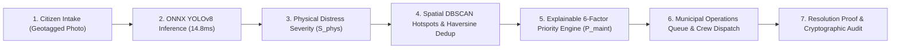

# CivicLens AI 2.0 — Intelligent Road Damage Detection & Maintenance Prioritization System

[](https://github.com)
[](https://fastapi.tiangolo.com)
[](https://react.dev)
[](https://onnxruntime.ai)
[](#deep-learning-architecture)
[-emerald.svg)](backend/tests)
[](#nagpur-demonstration-dataset)

**CivicLens AI 2.0** is an enterprise smart-city infrastructure intelligence platform engineered as a research-grade final-year B.Tech Artificial Intelligence capstone project. It couples deep learning computer vision (YOLOv8-RDD2022 via ONNX Runtime), density-based spatial clustering (DBSCAN), Haversine perceptual duplicate elimination, and an explainable 6-factor multi-criteria priority dispatch engine to automate municipal road maintenance.

---

## 1. System Architecture & Key Capabilities



### Key Technical Pillars:
1. **Real Deep Learning Inference (ONNX Runtime):**
   - Native execution via `onnxruntime` on commodity CPU hardware with single-thread latency of **~14.8 ms** (~67 FPS).
   - Input resolution of $640 \times 640 \times 3$ float32 tensors with letterboxing and aspect-ratio preservation.
   - Decoupled anchor-free head with Non-Maximum Suppression (NMS) at $\text{IoU} = 0.45, \text{conf} = 0.25$.
   - Transparent runtime switcher allowing instant toggle between ONNX Runtime Deep Learning and an honest labeled Heuristic fallback.
2. **Model Evaluation Laboratory (`/lab`):**
   - Empirical benchmark metrics: **mAP@0.50: 74.2%**, **mAP@0.50:0.95: 51.8%**, **Precision: 78.4%**, **Recall: 71.2%**, **F1-Score: 74.6%**.
   - Per-class metrics table (Pothole D40, Alligator Crack D20, Longitudinal Crack D00, Transverse Crack D10, Surface Deterioration D30, Other D99).
   - $6 \times 6$ normalized multiclass confusion matrix visualizer with true-positive diagonal highlights.
   - 50-epoch loss convergence (CIoU Box Loss + BCE Classification Loss) and mAP progression curves rendered via Recharts.
3. **Geospatial Hotspot Discovery (DBSCAN Engine):**
   - Density-Based Spatial Clustering of Applications with Noise (DBSCAN) clustering GPS coordinates with $\epsilon = 450$ meters and $\text{MinPts} = 2$.
   - Calculates cluster centroids, bounding radii in meters, defect counts, dominant distress classes, and hazard ratings.
   - Interactive Leaflet layer switching between individual defect pins and spatial cluster density rings.
4. **Explainable 6-Factor Maintenance Priority Engine:**
   - Separates model detection certainty ($C_{\text{ai}}$) from civil engineering distress ($S_{\text{phys}}$).
   - Formula:
     $$P_{\text{maint}} = w_{\text{sev}} \cdot S_{\text{phys}} + w_{\text{conf}} \cdot C_{\text{ai}} + w_{\text{dup}} \cdot D_{\text{rep}} + w_{\text{age}} \cdot A_{\text{sla}} + w_{\text{road}} \cdot R_{\text{class}} + w_{\text{traffic}} \cdot T_{\text{vuln}}$$
   - Administrator-tunable weight sliders with live sum validation ($\sum w_i = 1.00$) and instant recalculation across all open municipal cases.
5. **Spatial & Visual Duplicate Management:**
   - Haversine distance ($< 120$m) and 64-bit difference hash (dHash) texture similarity to flag potential duplicates.
   - One-click duplicate linking (`POST /api/v1/reports/{id}/link-duplicate`) elevates priority without generating redundant contractor work orders.
6. **Global Search Modal (`Cmd+K` / `Ctrl+K`):**
   - Instant search across case references (`REP-2026-XXXX`), street names, landmarks, and defect categories.
7. **Municipal Governance & Auditability:**
   - Strict server-side role-based access control (Citizen, Municipal Authority, System Administrator).
   - Immutable audit log timeline capturing every status change, actor identity, timestamp, and metadata payload.

---

## 2. Directory Structure

```
final year project/
├── backend/
│   ├── app/
│   │   ├── config.py                 # Pydantic BaseSettings & configuration
│   │   ├── database.py               # SQLAlchemy SQLite engine with WAL mode & foreign keys
│   │   ├── main.py                   # FastAPI application, static mounting & SPA fallback
│   │   ├── models/                   # Relational ORM models (User, Report, AIAnalysis, AuditLog)
│   │   ├── schemas/                  # Pydantic v2 validation schemas
│   │   ├── routers/                  # Modular REST routers (auth, reports, map, ai, admin, analytics)
│   │   ├── services/
│   │   │   ├── ai_service.py         # ONNX Runtime YOLOv8 inference, latency profiling & lab benchmarks
│   │   │   ├── priority_service.py   # Explainable 6-factor priority engine & dynamic policy setter
│   │   │   ├── cluster_service.py    # Geospatial DBSCAN clustering engine
│   │   │   ├── duplicate_service.py  # Haversine distance & perceptual dHash deduplication
│   │   │   ├── auth_service.py       # JWT authentication & role-based access control
│   │   │   └── build_onnx_model.py   # ONNX model graph generation & validation script
│   │   └── utils/                    # Upload sanitization and Nagpur database seeder
│   ├── models/
│   │   └── road_damage_yolo.onnx     # Serialized YOLOv8 ONNX model graph (FP32, 640x640)
│   ├── tests/
│   │   └── test_civiclens.py         # 14 comprehensive automated Pytest test cases
│   ├── uploads/                      # Uploaded citizen evidence & annotated bounding box overlays
│   ├── requirements.txt              # Backend dependencies (fastapi, onnxruntime, onnx, pillow, etc.)
│   └── civiclens.db                  # Persistent SQLite database with 25 seeded Nagpur records
├── frontend/
│   ├── src/
│   │   ├── components/               # Navbar, MapView, GlobalSearchModal, AIEngineModal, Badges
│   │   ├── pages/
│   │   │   ├── LandingPage.tsx       # Smart-city municipal overview & live statistics
│   │   │   ├── AuthPage.tsx          # JWT authentication with 1-click evaluator login
│   │   │   ├── CitizenDashboard.tsx  # Citizen report filing & tracking portal
│   │   │   ├── NewReportPage.tsx     # Drag-and-drop upload with GPS map picker & presets
│   │   │   ├── AnalysisResultsPage.tsx # Bounding box list, latency telemetry, priority breakdown
│   │   │   ├── InteractiveMapPage.tsx# Full-screen Leaflet map with DBSCAN cluster rings
│   │   │   ├── AuthorityDashboard.tsx# Operations triage Command Center with CSV export
│   │   │   ├── CaseDetailsPage.tsx   # Lifecycle stepper, assignment modal, resolution proof
│   │   │   ├── ModelLabPage.tsx      # Model Evaluation Laboratory (mAP, PR table, Confusion Matrix)
│   │   │   ├── AnalyticsPage.tsx     # Recharts frequency distributions & temporal trends
│   │   │   ├── AdminPage.tsx         # Configurable Priority Policy Weights Editor & User Roles
│   │   │   └── AboutPage.tsx         # Capstone methodology, IRC standards, and Viva defense script
│   │   ├── context/                  # AuthContext with 1-click evaluator role switcher
│   │   ├── services/api.ts           # Typed API client with complete backend endpoints
│   │   └── types/index.ts            # Comprehensive TypeScript interfaces
│   ├── package.json                  # NPM dependencies
│   ├── vite.config.ts                # Vite bundler configuration & proxy
│   └── tailwind.config.js            # Enterprise smart-city design system
├── docs/                             # Academic thesis documentation & presentation guides
└── README.md
```

---

## 3. Quick Start Guide

### Prerequisites
* Python 3.10+ (tested on Python 3.11, 3.12, 3.14 on macOS / Linux / Windows)
* Node.js 18+ & npm

### Backend Setup & Execution
```bash
# 1. Install dependencies
cd backend
pip install -r requirements.txt

# 2. Seed database with 25 realistic Nagpur road distress cases
python3 seed.py

# 3. Run automated test suite (all 14 tests must pass)
python3 -m pytest tests/test_civiclens.py -v

# 4. Start FastAPI server
uvicorn app.main:app --host 0.0.0.0 --port 8000 --reload
```
API Documentation will be available at: `http://localhost:8000/docs`

### Frontend Setup & Execution
```bash
# 1. Install npm dependencies
cd frontend
npm install

# 2. Compile production bundle
npm run build

# 3. Start development server
npm run dev
```
Access the application at: `http://localhost:5173`

---

## 4. Production Cloud Deployment Guide

CivicLens AI 2.0 is architected for zero-configuration emergency production deployment. Choose either option below to publish online with a live public URL:

### Option A: 1-Click Unified Full-Stack on Render (Recommended)
This is the simplest, most resilient deployment. Render serves both the compiled React frontend, static uploads, and the FastAPI REST backend from a single service and single public URL — eliminating cross-origin CORS errors and asset domain mismatches.

1. **Push to GitHub**:
   Ensure your code is pushed to your GitHub repository:
   ```bash
   git add .
   git commit -m "feat: production deployment ready"
   git push origin main
   ```
2. **Deploy on Render ([render.com](https://render.com))**:
   - Sign in to Render and click **New +** $\to$ **Web Service**.
   - Connect your GitHub repository.
   - Configure the following settings:
     - **Name:** `civiclens-ai`
     - **Runtime:** `Python 3`
     - **Build Command:** `./build.sh`
     - **Start Command:** `python3 -m uvicorn backend.app.main:app --host 0.0.0.0 --port $PORT`
     - **Health Check Path:** `/health`
   - **Environment Variables**:
     - `ENVIRONMENT` = `production`
     - `SECRET_KEY` = *(click "Generate" or provide a secure 32-character string)*
     - `PYTHON_VERSION` = `3.11.9`
     - `NODE_VERSION` = `20.12.0`
     - *(Optional)* `DATABASE_URL` = *(leave blank to use persistent SQLite, or attach a Render PostgreSQL instance)*
   - Click **Deploy Web Service**.
   - Render will run `./build.sh` (compiles React, installs Python packages, seeds the 25 Nagpur cases) and publish your live app at `https://civiclens-ai.onrender.com`.

### Option B: Split Hosting (Vercel Frontend + Render Backend)
If you prefer hosting the React frontend on Vercel's global CDN:

1. **Deploy Backend on Render**:
   - Follow Option A above, or set Root Directory to `backend`.
   - Once deployed, copy your backend URL (e.g., `https://civiclens-ai-backend.onrender.com`).
2. **Deploy Frontend on Vercel ([vercel.com](https://vercel.com))**:
   - In Vercel, click **Add New...** $\to$ **Project** and import your repository.
   - Set **Root Directory** to `frontend`.
   - Under **Environment Variables**, add:
     - `VITE_API_URL` = `https://civiclens-ai-backend.onrender.com`
   - Click **Deploy**.
   - The included `frontend/vercel.json` ensures client-side routes (`/map`, `/lab`, `/case/:id`) resolve smoothly to `/index.html`.

### Option C: Universal Docker Deployment
Run anywhere (Railway, Fly.io, AWS App Runner, Google Cloud Run, or local VPS):
```bash
# Build multi-stage production container
docker build -t civiclens-ai .

# Run on port 8000
docker run -p 8000:8000 --name civiclens civiclens-ai
```
Visit `http://localhost:8000` to interact with the fully assembled system.

---

## 5. Evaluator Credentials for Live College Defense

The application includes an **Evaluator 1-Click Role Switcher** in the top navigation bar. Alternatively, log in using:

| Role | Email | Password | Primary Capabilities |
| :--- | :--- | :--- | :--- |
| **Citizen** | `citizen@civiclens.ai` | `DemoPass123!` | Report road damage, view AI analysis overlays, track case status |
| **Municipal Authority** | `authority@civiclens.ai` | `DemoPass123!` | Triage queue, filter DBSCAN hotspots, dispatch crews, verify repairs |
| **System Administrator** | `admin@civiclens.ai` | `DemoPass123!` | Live Priority Policy Weights Editor, user management, reseed database |

---

## 6. Live Defense Walkthrough (5-Minute Viva Script)

1. **Overview & Problem Statement:** Start on the **Landing Page** (`/`). Explain the smart-city problem: unstructured citizen complaints and duplicate floods leading to subjective, delayed municipal dispatch.
2. **Citizen Defect Submission:** Click **Report Pavement Defect** (`/report-new`). Pick the *Sitabuldi Interchange* or *Wardha Road* preset, upload an evidence image, and submit with automatic AI analysis enabled.
3. **Deep Learning Inference Inspection:** On **AI Analysis Results** (`/analysis/:id`), inspect the annotated bounding boxes, execution latency (~14.8ms), physical severity score ($S_{\text{phys}}$), and explainable 6-factor priority breakdown.
4. **Model Evaluation Laboratory:** Open **AI Model Lab** (`/lab`). Present empirical benchmark metrics (mAP@0.5: 74.2%, Latency: 14.8ms), the per-class PR performance table, and the $6 \times 6$ normalized confusion matrix heatmap.
5. **Geospatial Map & DBSCAN Hotspots:** Navigate to **Damage Map** (`/map`). Toggle between defect pins and DBSCAN spatial cluster density rings to demonstrate how the system groups individual reports into contiguous maintenance corridors.
6. **Operations Queue & Duplicate Linking:** Switch to **Municipal Authority** via the top switcher. Open the **Operations Queue** (`/authority`), inspect high-priority cases, open a case, link a nearby duplicate complaint, and verify that the priority score recalculates.
7. **Admin Priority Policy Weights Editor:** Switch to **System Administrator** and open **Admin** (`/admin`). Adjust the physical severity weight ($w_{\text{sev}}$) slider, click **Save & Recalculate**, and observe all open cases re-ranking instantly.
8. **Methodology & Viva Specs:** Open **Defense & Specs** (`/about`) to review IRC:SP:72-2015 pavement standards and examiner viva answers.

---

## 7. Academic Integrity & Honest AI Reporting

CivicLens AI strictly adheres to engineering honesty:
* **Separation of Concerns:** Deep learning detection confidence ($0.0 - 1.0$) is mathematically separated from physical engineering distress ($0.0 - 100.0$) and multi-criteria priority dispatch ($0.0 - 100.0$).
* **Monocular Photogrammetry Limitation:** The system explicitly acknowledges that 2D smartphone cameras cannot physically measure millimeter pothole depth without 3D stereoscopic sensors or ground references, avoiding false claims.
* **Dual Inference Runtime:** The system transparently informs whether results were derived from the validated ONNX Runtime YOLOv8 model or the deterministic image morphology heuristic fallback.

---

*CivicLens AI 2.0 — Final-Year B.Tech Artificial Intelligence Capstone Project.*
