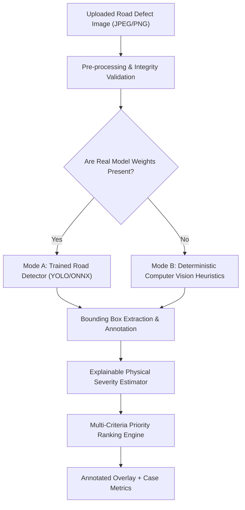

# CivicLens AI: Artificial Intelligence & Computer Vision Methodology

---

## 1. Dual-Mode Architecture Overview

CivicLens AI employs a modular, decoupled computer vision architecture designed for academic rigor, operational reliability, and transparent failure modes.

* **Mode A (Real Deep Learning Inference):** Activated when trained PyTorch/ONNX road damage detector weights (`models/road_damage_weights.pt`) are present on disk. Executes object detection, generates class predictions, and computes bounding coordinates.
* **Mode B (Deterministic Computer Vision Heuristic Fallback):** When custom trained weights are absent, the system does not fabricate fake outputs. Instead, it computes authentic image morphology features (Laplacian edge energy, grayscale luminance variance, and dark cavity contours) using Pillow and NumPy. The result is visibly tagged with:  
  `DEMO ANALYSIS — NOT A VALIDATED AI PREDICTION`.

---

## 2. Pavement Distress Taxonomy

The system defines 6 pavement distress classes aligned with the international **Crowd-sourced Road Damage Dataset (CRDDC / RDD2022)** and standard Indian Road Congress (IRC) maintenance specifications:

| Class Code | Category Name | Pavement Failure Mechanism | Class Multiplier ($M_c$) |
| :--- | :--- | :--- | :--- |
| `D40` | **Pothole** | Structural moisture penetration causing base displacement and surface hole. | **1.00** |
| `D20` | **Alligator cracking** | Repetitive axle load fatigue failure in the wheelpath. | **0.85** |
| `D10` | **Transverse crack** | Thermal contraction across pavement width perpendicular to centerline. | **0.70** |
| `D00` | **Longitudinal crack** | Joint separation or linear fatigue along travel direction. | **0.65** |
| `D30` | **Surface deterioration** | Bitumen binder oxidation, raveling, and loss of fine aggregate. | **0.50** |
| `D99` | **Other / uncertain** | Non-structural expansion gaps, construction joints, or surface stains. | **0.30** |

---

## 3. Explainable Physical Severity Estimation Model

Black-box neural networks output class logits and bounding boxes, but do not provide a direct civil engineering severity score. CivicLens AI bridges this gap with an explainable formulation:

$$\text{Severity} = \min\left(100.0, \; 0.50 \cdot S_{\text{area}} + 0.20 \cdot S_{\text{count}} + 0.30 \cdot S_{\text{class}}\right)$$

### Component Formulations:

1. **Normalized Defect Area Ratio ($S_{\text{area}}$):**
   $$S_{\text{area}} = \min\left(100.0, \; \frac{\sum_{i=1}^{N} \text{width}_i \cdot \text{height}_i}{\text{Image Width} \cdot \text{Image Height}} \times 380.0\right)$$
   A larger fraction of the road surface occupied by detected distress directly increases the physical score.

2. **Defect Count Density ($S_{\text{count}}$):**
   $$S_{\text{count}} = \min\left(100.0, \; N \times 33.3\right)$$
   Multiple defects in a single field of view represent severe pavement network degradation.

3. **Maximum Distress Class Multiplier ($S_{\text{class}}$):**
   $$S_{\text{class}} = \left(\max_{i \in \{1,\dots,N\}} M_{c_i}\right) \times 100.0$$
   Reflects the peak hazard category detected (e.g., potholes penalize more heavily than minor surface raveling).

### Severity Levels:
* **CRITICAL:** $\ge 75.0$ (Severe immediate road hazard; high collision risk)
* **HIGH:** $50.0 - 74.9$ (Active structural failure; urgent repair window)
* **MEDIUM:** $25.0 - 49.9$ (Moderate distress; scheduled maintenance batch)
* **LOW:** $< 25.0$ (Minor surface defect; routine monitoring)

---

## 4. Multi-Criteria Priority Ranking Engine

Maintenance resources in municipal corporations are resource-constrained. CivicLens AI ranks maintenance queues through an explainable multi-criteria model:

$$\text{Priority} = w_{\text{sev}} S + w_{\text{conf}} (C \cdot 100) + w_{\text{dup}} D + w_{\text{age}} A + w_{\text{road}} R$$

Where the default calibrated weights are:
* $w_{\text{sev}} = 0.40$ (Physical defect severity)
* $w_{\text{conf}} = 0.20$ (Detection evidence quality)
* $w_{\text{dup}} = 0.15$ (Public complaint signal / repeat reports)
* $w_{\text{age}} = 0.15$ (Aging delay penalty: $+5\text{ pts/day}$ waiting)
* $w_{\text{road}} = 0.10$ (Roadway hierarchy: Highway = 100, Arterial = 85, Collector = 65, Local = 40)

$$\sum w_i = 0.40 + 0.20 + 0.15 + 0.15 + 0.10 = 1.00$$

Every case displays an exact point contribution breakdown, allowing municipal engineers to audit why a ticket is ranked in the priority queue.

---

## 5. Geospatial & Visual Duplicate Detection

To prevent municipal duplicate ticket storms, candidate matching combines:
1. **Haversine Distance:**
   $$d = 2R \arcsin\left(\sqrt{\sin^2\left(\frac{\Delta\phi}{2}\right) + \cos(\phi_1)\cos(\phi_2)\sin^2\left(\frac{\Delta\lambda}{2}\right)}\right)$$
   Candidate spatial threshold: $d \le 120\text{ meters}$.
2. **Perceptual Difference Hashing (dHash):**
   * Resizes image to $9 \times 8$ grayscale.
   * Compares luminance gradients between horizontally adjacent pixels to generate a 64-bit fingerprint.
   * Normalized Hamming visual similarity $V = 1.0 - \frac{\text{HammingDist}}{64}$.
3. **Composite Duplicate Score:**
   $$\text{Score}_{\text{dup}} = 0.55 \cdot (1 - d/120) + 0.25 \cdot V + 0.20 \cdot (1 - \Delta t/45)$$
   Cases scoring $\ge 0.50$ are flagged as potential duplicates for supervisor review.

---

## 6. Academic Limitations & Ethical Civic AI Boundary

1. **Photogrammetric Monocular Limitation:** Ordinary smartphone photographs do not possess calibrated depth information. Physical pothole volume (in liters) or depth (in millimeters) cannot be physically measured without stereoscopic cameras, LiDAR, or fixed ground calibration targets. The severity score is an advisory visual index, not an ultrasonic pavement test.
2. **Decision Support Nature:** CivicLens AI acts as an advisory assistant to human civil engineers. It does not automatically dispatch asphalt contractors without human oversight.
