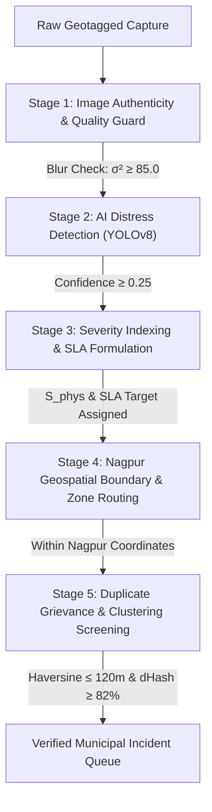

# CivicLens AI — 5-Stage Automated Verification Engine Specification

## 1. Overview & Theoretical Framework

Municipal infrastructure departments frequently suffer from complaint backlogs inundated with duplicate reports, blurry or unidentifiable photographs, out-of-jurisdiction submissions, and exaggerated emergency claims.

To resolve these inefficiencies, **CivicLens AI** introduces an automated **5-Stage Verification Engine** that evaluates every incoming pavement distress report sequentially before committing it to municipal action queues.

---

## 2. Detailed Mathematical & Algorithmic Specifications

### Stage 1: Photographic Authenticity & Quality Guard

The first gate rejects uninterpretable, dark, out-of-focus, or synthetic images that would generate spurious object detections.

1. **Blur Detection via Laplacian Variance:**
   The image is converted to single-channel 8-bit grayscale $I(x, y)$, and convolved with the discrete Laplacian operator:
   $$\nabla^2 I = \frac{\partial^2 I}{\partial x^2} + \frac{\partial^2 I}{\partial y^2}$$
   Discrete kernel approximation:
   $$K_L = \begin{bmatrix} 0 & 1 & 0 \\ 1 & -4 & 1 \\ 0 & 1 & 0 \end{bmatrix}$$
   The sharpness variance $\sigma_L^2$ is defined as:
   $$\sigma_L^2 = \frac{1}{N} \sum_{x, y} \left( (\nabla^2 I)(x, y) - \mu_{\nabla^2 I} \right)^2$$
   - **Quality Threshold:** $\sigma_L^2 \ge 85.0$ (Images below $85.0$ are classified as blurry / out-of-focus).

2. **Illumination Contrast Check:**
   Image mean luminance $\mu_I$ must satisfy:
   $$25.0 \le \mu_I \le 235.0$$
   Images outside this range represent underexposed night captures without road illumination or overexposed direct glare.

---

### Stage 2: Computer Vision Defect Localization (ONNX YOLOv8-RDD2022)

Road defects are detected using an optimized **YOLOv8** network trained on the Road Damage Dataset (RDD2022).

- **Input Preprocessing:** RGB tensor normalized to $[0.0, 1.0]$, bicubic letterbox resized to $(1, 3, 640, 640)$.
- **Inference Runtime:** Native `onnxruntime` executing on CPU or CoreML execution providers.
- **Bounding Box Decoding & NMS:**
  - Non-Maximum Suppression (NMS) Intersection over Union: $\text{IoU}_{\text{thresh}} = 0.45$.
  - Detection Softmax Confidence: $\tau_{\text{conf}} = 0.25$.
- **Target Distress Categories:**
  - `Pothole` (Class D40 in RDD2022)
  - `Alligator cracking` (Class D20)
  - `Longitudinal crack` (Class D00)
  - `Transverse crack` (Class D10)
  - `Surface deterioration` / Ravelling

---

### Stage 3: Surface Area Estimation, Physical Severity & SLA Formulation

Unlike subjective citizen reporting, CivicLens estimates defect surface area and applies Indian Road Congress (IRC:SP:72-2015) structural weights.

1. **Optical Ground Surface Area Estimation ($A_{\text{defect}}$ in $m^2$):**
   Given camera focal distance $f$, sensor height $H_{\text{camera}} \approx 1.35\text{m}$ (standard standing citizen capture angle of $45^\circ$), Ground Sampling Distance (GSD) is approximated as:
   $$\text{GSD} \approx \frac{H_{\text{camera}}}{f \cdot \cos(\theta)} \approx 0.0018 \text{ m/pixel}$$
   The physical area for bounding box dimensions $(w_{px}, h_{px})$ is:
   $$A_{\text{defect}} = \sum_{k=1}^{N_{boxes}} \left( w_k \cdot h_k \cdot \text{GSD}^2 \right) \text{ m}^2$$

2. **Physical Severity Score Formula ($S_{phys}$):**
   $$S_{phys} = \min\left(100.0, \; 50.0 \cdot R_{area} + 20.0 \cdot \min(1.0, \frac{N_{boxes}}{4}) + 30.0 \cdot W_{class}\right)$$
   Where:
   - $R_{area} = \frac{\sum \text{Area}_{box}}{\text{Image Area}}$
   - $W_{class} \in \{1.0 \text{ for Potholes}, 0.75 \text{ for Alligator Cracks}, 0.50 \text{ for Transverse/Longitudinal Cracks}\}$

3. **Service Level Agreement (SLA) Resolution Window:**
   The municipal response deadline is dynamically calculated:
   $$\text{SLA Target} = \begin{cases}
     24 \text{ Hours} & \text{if } S_{phys} \ge 75.0 \text{ (CRITICAL)} \\
     48 \text{ Hours} & \text{if } 50.0 \le S_{phys} < 75.0 \text{ (HIGH)} \\
     7 \text{ Days} & \text{if } 25.0 \le S_{phys} < 50.0 \text{ (MEDIUM)} \\
     14 \text{ Days} & \text{if } S_{phys} < 25.0 \text{ (LOW)}
   \end{cases}$$

---

### Stage 4: Nagpur Municipal Boundary Validation & Zonal Allocation

Reports must lie within the statutory administrative boundaries of Nagpur Municipal Corporation.

1. **Metropolitan Bounding Box Gate:**
   $$\text{Latitude} \in [20.9500^\circ\text{N}, 21.3200^\circ\text{N}], \quad \text{Longitude} \in [78.9000^\circ\text{E}, 79.3000^\circ\text{E}]$$
   Coordinates outside this perimeter are rejected as out-of-jurisdiction submissions.

2. **Administrative Zone Allocation:**
   Points are routed to the nearest administrative zonal center among the 10 official NMC Zones:
   - Zone 1: Laxmi Nagar
   - Zone 2: Dharampeth
   - Zone 3: Hanuman Nagar
   - Zone 4: Dhantoli
   - Zone 5: Nehru Nagar
   - Zone 6: Gandhibagh
   - Zone 7: Satranjipura
   - Zone 8: Lakadganj
   - Zone 9: Ashi Nagar
   - Zone 10: Mangalwari

---

### Stage 5: Duplicate Grievance & Recurrence Screening

To prevent duplicate repair crew dispatches while amplifying citizen signal for high-traffic defects, Stage 5 executes two-tier duplicate checking:

1. **Haversine Geodesic Distance Matrix ($d_H$):**
   $$d_H = 2R \arcsin\left(\sqrt{\sin^2\left(\frac{\Delta \phi}{2}\right) + \cos(\phi_1)\cos(\phi_2)\sin^2\left(\frac{\Delta \lambda}{2}\right)}\right)$$
   Where earth radius $R = 6,371,000\text{m}$.
   - Spatial candidate radius: $d_H \le 120.0\text{ meters}$.

2. **Perceptual Difference Hash (dHash) Image Similarity:**
   Images of nearby reports are resized to $9 \times 8$ grayscale, gradients between adjacent columns are converted to a 64-bit binary vector, and Hamming distance $D_{Hamming}$ is evaluated:
   $$\text{Sim}_{visual} = 1.0 - \frac{D_{Hamming}}{64.0}$$
   - **Duplicate Threshold:** $d_H \le 120\text{m}$ AND $\text{Sim}_{visual} \ge 0.82$.
   - When matched, the existing case priority is incremented without creating redundant contractor work orders.

---

## 3. Persistent Verification Stage Schema

Each stage logs full telemetry into `report_verification_stages`:

| Field | Type | Description |
| :--- | :--- | :--- |
| `stage_number` | Integer (1 - 5) | Sequential pipeline index |
| `stage_name` | String(100) | Human-readable verification title |
| `status` | Enum | `PASSED`, `FLAGGED`, `REJECTED`, `BYPASSED` |
| `score` | Float | Normalized confidence / metric score ($0.0 - 1.0$) |
| `summary` | Text | Diagnostic decision narrative |
| `evidence_json` | JSON Text | Machine-readable metrics (Laplacian variance, tensor dimensions, GSD, distances) |
| `created_at` | DateTime | Immutable ISO 8601 UTC timestamp |
