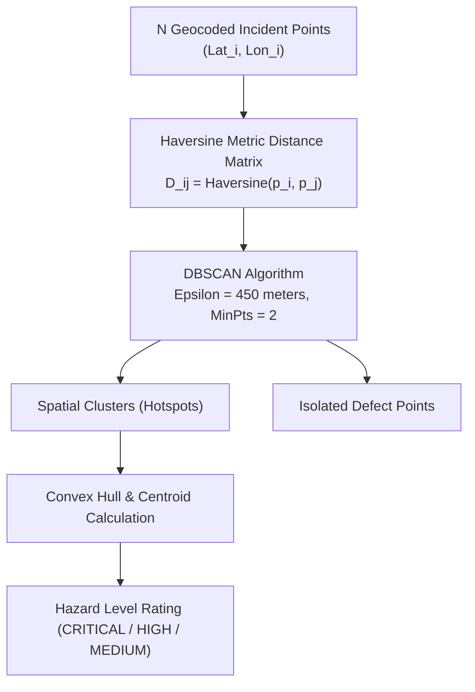

# CivicLens AI — Nagpur GIS & Spatial Intelligence Specification

## 1. Metropolitan Geographical Scope: Nagpur, Maharashtra

Nagpur is the third largest city and winter capital of Maharashtra, India, spanning an urban municipal boundary of approximately **$217.56 \text{ km}^2$**. 

### Geographic Extent & Reference System
- **Centroid Coordinates:** $21.1458^\circ\text{ N}, \; 79.0882^\circ\text{ E}$ (Zero Mile Stone Marker, Sitabuldi).
- **Coordinate Reference System (CRS):** WGS 84 (EPSG:4326), projected to UTM Zone 44N (EPSG:32644) for metric distance calculations.
- **Bounding Coordinates:**
  - Latitude: $[20.9500^\circ\text{N}, 21.3200^\circ\text{N}]$
  - Longitude: $[78.9000^\circ\text{E}, 79.3000^\circ\text{E}]$

---

## 2. 10 Municipal Administrative Zones (NMC Jurisdiction)

The Nagpur Municipal Corporation administers the city across **10 statutory zones**:

| Zone # | Zone Name | Representative Landmark | Latitude | Longitude | Office Contact |
| :---: | :--- | :--- | :---: | :---: | :--- |
| **1** | Laxmi Nagar | Bajaj Nagar Square, Ring Road | 21.1180 | 79.0620 | 0712-2567001 |
| **2** | Dharampeth | Coffee House Square, WHC Road | 21.1420 | 79.0620 | 0712-2567002 |
| **3** | Hanuman Nagar | Medical College Square, Tukdoji Sq | 21.1210 | 79.0980 | 0712-2567003 |
| **4** | Dhantoli | Sitabuldi Metro, Panchsheel Square | 21.1390 | 79.0840 | 0712-2567004 |
| **5** | Nehru Nagar | Sakkardara Lake, Great Nag Road | 21.1250 | 79.1180 | 0712-2567005 |
| **6** | Gandhibagh | Central Avenue, Mahal Heritage | 21.1520 | 79.1050 | 0712-2567006 |
| **7** | Satranjipura | Itwari Railway Station, Maskasath | 21.1680 | 79.1120 | 0712-2567007 |
| **8** | Lakadganj | Kamptee Road, Kalamna Market | 21.1590 | 79.1350 | 0712-2567008 |
| **9** | Ashi Nagar | Jaripatka, Indora Square | 21.1850 | 79.0950 | 0712-2567009 |
| **10** | Mangalwari | Sadar Mount Road, Katol Road | 21.1710 | 79.0720 | 0712-2567010 |

---

## 3. Spatial DBSCAN Density-Based Clustering Algorithm

Individual pothole reports do not provide adequate context for heavy machinery dispatch (e.g., asphalt pavers, cold milling machines). CivicLens aggregates isolated reports into **actionable maintenance corridors** via **Density-Based Spatial Clustering of Applications with Noise (DBSCAN)**:

### DBSCAN Parameter Formulation
- **Neighborhood Radius ($\epsilon$):** $450.0 \text{ meters}$ (representing typical municipal maintenance segment lengths on urban arterial roads).
- **Minimum Core Samples ($\text{MinPts}$):** $2 \text{ reports}$.
- **Metric:** Haversine Great-Circle Distance ($d_H$).

### Hotspot Hazard Rating Formulation ($H_{\text{cluster}}$)
$$\text{HazardScore} = \left(\frac{N_{\text{reports}}}{5.0}\right) \cdot \overline{S}_{\text{phys}} \cdot W_{\text{dominant}}$$
- **CRITICAL Hazard:** $\text{HazardScore} \ge 60.0$ (Immediate road closure or cold-mix patching within 24h).
- **HIGH Hazard:** $35.0 \le \text{HazardScore} < 60.0$.
- **MEDIUM Hazard:** $\text{HazardScore} < 35.0$.

---

## 4. Multi-Layer Geospatial Visualization Architecture

The frontend map canvas (`MapView.tsx` + Leaflet 1.9) provides a non-proprietary spatial stack:

1. **Tile Layer Resiliency:** Primary OpenStreetMap cartography with automatic multi-provider fallback to Esri World Street Map and Esri Canvas without requiring proprietary billing tokens.
2. **Defect Pins Layer:** Color-coded SVG div icons representing IRC severity tiers (Red: $\ge 75$, Orange: $50-74$, Amber: $25-49$, Green: $<25$).
3. **Cluster Overlay Layer:** Translucent SVG boundary circles centered on hotspot centroids with dashed hazard boundaries.
4. **Administrative Ward Layer:** GeoJSON polygon boundaries outlining all 10 NMC municipal zones with tooltip hover telemetry displaying active defect counts and zonal officer contacts.
5. **Turn-by-Turn Navigation:** Deep-links to Google Maps directions (`https://www.google.com/maps/dir/?api=1&destination=lat,lon`) for direct field crew dispatch.
