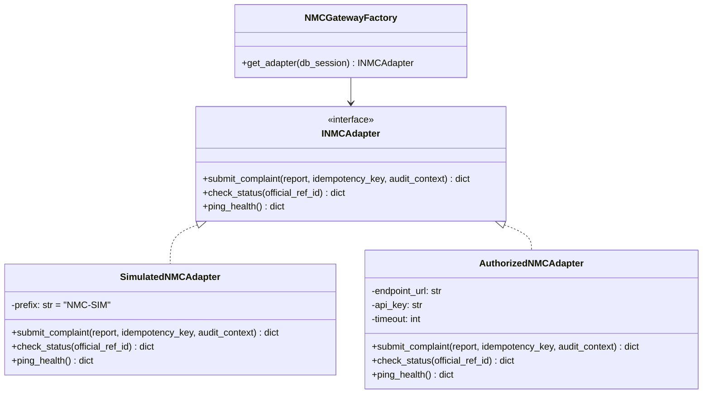

# CivicLens AI — NMC Integration Architecture & Interface Specification

## 1. Scope, Purpose & Non-Affiliation Safeguards

This document formalizes the integration contract between the **CivicLens AI** civic intelligence platform and the municipal grievance systems of the **Nagpur Municipal Corporation (NMC)**, Nagpur, Maharashtra, India.

### Academic Demonstration Notice & Ethics Protocol
> **CRITICAL DISCLOSURE RULE:** CivicLens AI is an academic research engineering prototype developed for final-year engineering evaluation. Unless explicitly configured with signed administrative Memorandum of Understanding (MoU) credentials and verified against an authorized endpoint, **CivicLens AI operates strictly in Demonstration / Simulated mode**.
>
> 1. The software NEVER attempts to bypass CAPTCHA, scrape citizen sessions, or breach government access controls.
> 2. Simulated reference numbers are explicitly prefixed with `[SIMULATED DEMONSTRATION MODE]` or `NMC-SIM-YYYY-XXXX`.
> 3. Assisted citizen handoffs direct users to the verified official public complaint portal:
>    `https://nmcnagpur.gov.in/grievance/complaint_form.php`

---

## 2. Enterprise Integration Adapter Architecture

CivicLens implements the **Adapter Design Pattern** to isolate municipal integration logic from core business logic:



---

## 3. Idempotency Key Mechanics & Deduplication

To prevent duplicate grievance creation during network retries or concurrent clicks, all dispatches mandate an **Idempotency Key**:

1. **Key Generation Formula:**
   $$\text{IdempotencyKey} = \text{SHA256}(\text{ReferenceNumber} + \text{Latitude}_{4dp} + \text{Longitude}_{4dp} + \text{WindowHour})$$
2. **Transaction Audit Table (`nmc_transaction_audits`):**
   - Before any external HTTP call or synthetic dispatch, the database is queried for `idempotency_key`.
   - If an existing record exists with HTTP 200/201, the cached response and reference ID are returned immediately without secondary dispatch.
   - If no record exists, the transaction is locked in `PENDING` state and committed upon gateway completion.

---

## 4. Municipal Grievance Payload Contract

### Outbound Complaint Dispatch (JSON Specification)

```json
{
  "header": {
    "system_id": "CIVICLENS_AI_NAGPUR",
    "version": "2.0.0",
    "timestamp_utc": "2026-11-19T18:00:00Z",
    "idempotency_key": "e3b0c44298fc1c149afbf4c8996fb92427ae41e4649b934ca495991b7852b855"
  },
  "complaint_payload": {
    "civiclens_reference_number": "CVL-2026-0012",
    "incident_title": "Severe Cavity and Asphalt Ravelling near Dharampeth WHC Road",
    "defect_classification": {
      "primary_distress": "Pothole",
      "irc_sp_72_code": "D40",
      "ai_model_confidence": 0.942,
      "estimated_surface_area_sqm": 0.85
    },
    "severity_telemetry": {
      "physical_severity_score": 78.4,
      "severity_level": "CRITICAL",
      "priority_score": 84.1,
      "sla_resolution_target_hours": 24
    },
    "geospatial_location": {
      "latitude": 21.1420,
      "longitude": 79.0620,
      "address_text": "West High Court Road, Dharampeth, Nagpur",
      "nagpur_zone_number": 2,
      "nagpur_ward_name": "Dharampeth",
      "prominent_landmark": "Near Coffee House Square"
    },
    "reporter_meta": {
      "citizen_name": "Ayush Vinchurkar",
      "masked_contact": "+91 98******12",
      "reporter_role": "CITIZEN_MOBILE_APP"
    }
  }
}
```

### Inbound Gateway Response (Simulated Mode Example)

```json
{
  "status": "SUCCESS",
  "http_code": 201,
  "data": {
    "official_reference_id": "NMC-SIM-2026-0814",
    "registration_timestamp": "2026-11-19T18:00:01Z",
    "assigned_zone": "Zone 2 (Dharampeth)",
    "assigned_zonal_officer": "Dharampeth Zonal Assistant Municipal Commissioner",
    "grievance_category": "Road Maintenance & Pothole Repair (Code 104)",
    "expected_resolution_date": "2026-11-20T18:00:00Z",
    "tracking_url": "https://nmcnagpur.gov.in/grievance/status.php?ref=NMC-SIM-2026-0814",
    "disclaimer": "[SIMULATED DEMONSTRATION MODE] Grievance record validated and logged inside CivicLens simulated integration sandbox."
  }
}
```

---

## 5. Transaction Audit & Non-Repudiation Schema

Every interaction is immutably logged into `nmc_transaction_audits`:

| Column | Type | Constraints | Description |
| :--- | :--- | :--- | :--- |
| `id` | Integer | PK, Auto | Audit serial identifier |
| `report_id` | Integer | FK, Indexed | Foreign key to `road_damage_reports.id` |
| `idempotency_key` | String(64) | Unique, Indexed | SHA-256 idempotency hash |
| `transaction_type` | String(50) | Not Null | `DISPATCH_NEW`, `STATUS_QUERY`, `HEALTH_PING` |
| `external_status` | String(50) | Not Null | `SIMULATED_SUCCESS`, `SUCCESS`, `TIMEOUT_ERROR`, `AUTH_REJECTED` |
| `official_reference_id`| String(100) | Nullable, Indexed | External government complaint reference number |
| `request_payload_json` | Text | Nullable | Complete JSON outbound payload |
| `response_payload_json`| Text | Nullable | Complete JSON gateway response |
| `http_status_code` | Integer | Not Null | HTTP return code (200, 201, 400, 502) |
| `retry_count` | Integer | Default 0 | Automatic retry attempts executed |
| `timestamp` | DateTime | Not Null | UTC timestamp of dispatch |
