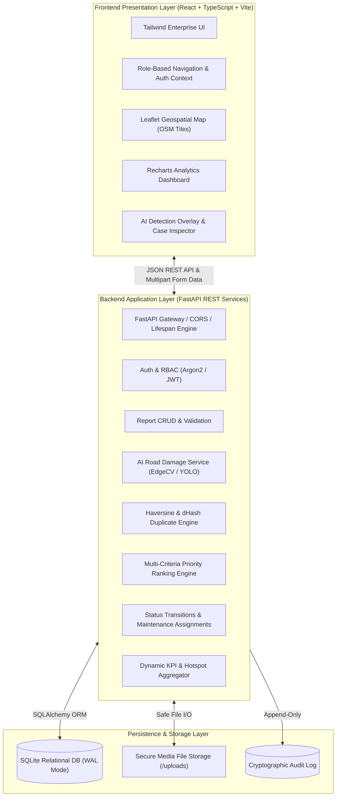
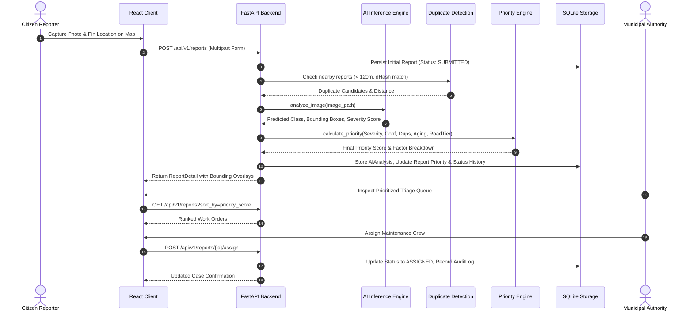
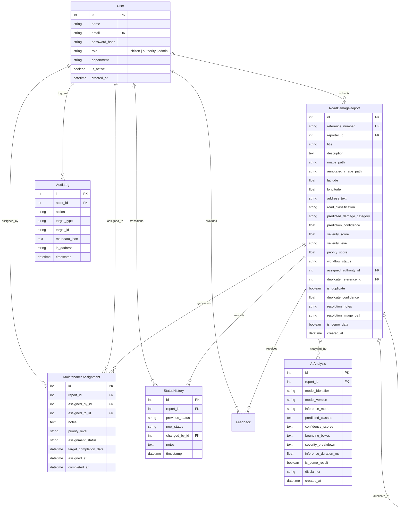

# CivicLens AI: System Architecture & Technical Design

---

## 1. High-Level Component Architecture

CivicLens AI follows a modular, decoupled client-server architecture ensuring high maintainability, stateless API scalability, and clean separation of concerns.

---

## 2. End-to-End Defect Triage Data Flow

---

## 3. Database Entity-Relationship Model

---

## 4. REST API Endpoint Specifications

All REST endpoints are versioned under `/api/v1` and documented in Swagger UI at `/docs`.

| Method | Endpoint | Description | Role Authorization |
| :--- | :--- | :--- | :--- |
| `GET` | `/api/v1/health` | Service health, DB connection, AI engine mode | Public |
| `POST` | `/api/v1/auth/register` | User account registration | Public |
| `POST` | `/api/v1/auth/login` | JWT authentication token issuance | Public |
| `GET` | `/api/v1/auth/me` | Fetch active profile and permissions | Authenticated |
| `GET` | `/api/v1/reports` | List reports with search, filters, pagination | Public / Auth |
| `POST` | `/api/v1/reports` | Create report with photo upload & coordinates | Public / Citizen |
| `GET` | `/api/v1/reports/{id}` | Full case details, analyses, history, duplicates | Public / Auth |
| `PATCH` | `/api/v1/reports/{id}` | Edit report title or classification | Reporter / Authority |
| `DELETE` | `/api/v1/reports/{id}` | Remove report record | Admin only |
| `POST` | `/api/v1/reports/{id}/analyze` | Trigger manual computer vision re-inference | Authenticated |
| `POST` | `/api/v1/reports/{id}/assign` | Assign maintenance crew to defect | Authority / Admin |
| `POST` | `/api/v1/reports/{id}/status` | Transition legal lifecycle status | Authority / Admin |
| `POST` | `/api/v1/reports/{id}/resolve` | Close case with maintenance evidence photo | Authority / Admin |
| `GET` | `/api/v1/map/reports` | Optimized geo-points for Leaflet map markers | Public |
| `GET` | `/api/v1/analytics/overview` | Dynamic municipal KPI counters | Public |
| `GET` | `/api/v1/analytics/trends` | Category, severity, and hotspot aggregations | Public |
| `GET` | `/api/v1/admin/users` | List all registered user accounts | Admin only |
| `PATCH` | `/api/v1/admin/users/{id}/role` | Update user roles and access status | Admin only |
| `POST` | `/api/v1/admin/reseed` | Restore synthetic Nagpur demo fixtures | Admin only |
| `GET` | `/api/v1/admin/system-status` | DB entity counts, storage, AI engine stats | Authority / Admin |
| `GET` | `/api/v1/audit-logs` | Cryptographic audit trail of system events | Authority / Admin |
