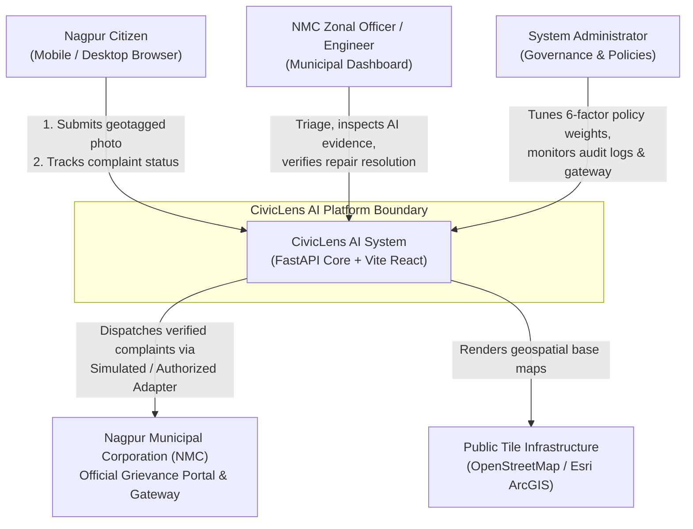
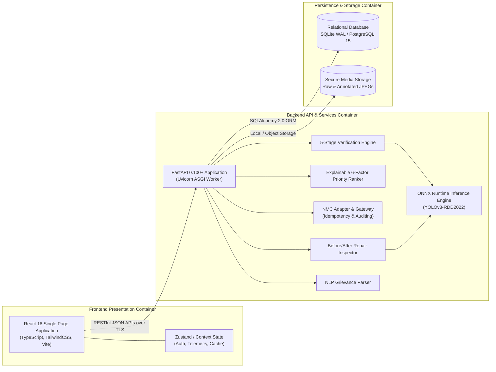
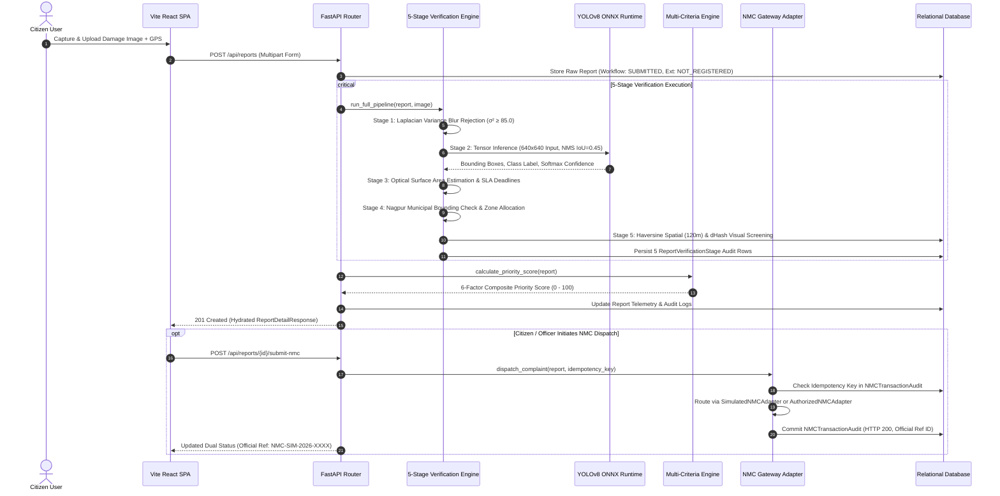

# CivicLens AI — System Architecture & Engineering Specification

## 1. Executive Summary & Architectural Overview

**CivicLens AI** is an enterprise-grade civic infrastructure intelligence and municipal grievance orchestration platform engineered specifically for the metropolitan urban jurisdiction of **Nagpur Municipal Corporation (NMC)**, Maharashtra, India. 

The system transitions municipal road maintenance from passive, unverified citizen complaints to an **automated, evidence-verified, priority-ranked infrastructure management lifecycle**. By pairing lightweight edge-capable computer vision models (ONNX Runtime YOLOv8) with an Explainable Multi-Criteria Priority Engine and a robust Municipal Integration Gateway, CivicLens AI bridges the technological divide between citizens and urban local bodies.

---

## 2. High-Level Architectural Models (C4 Model)

### Level 1: System Context Diagram

---

### Level 2: Container Architecture

The system is decomposed into four primary decoupled containers:

---

### Level 3: Component Interactions & Verification Flow

---

## 3. Dual-Status Lifecycle Synchronization Model

To prevent false claims of government submission while providing a complete civic operations simulation, CivicLens maintains **two orthogonal status fields** on every incident record:

| Aspect | Internal Workflow Status (`workflow_status`) | External Municipal Submission Status (`external_submission_status`) |
| :--- | :--- | :--- |
| **Authority** | Controlled by CivicLens AI and municipal triage officers. | Controlled exclusively by the NMC Municipal Gateway Adapter. |
| **Allowed Values** | `SUBMITTED` `UNDER_REVIEW` `ACTION_PLANNED` `IN_PROGRESS` `RESOLVED` `REJECTED` | `NOT_REGISTERED` `PENDING_VERIFICATION` `OFFICIALLY_REGISTERED` `RESOLVED_ON_PORTAL` `PORTAL_REJECTED` |
| **Purpose** | Drives operational repair workflow, SLA countdowns, priority queuing, and field assignments. | Reflects non-repudiable state in the municipal gateway with external reference numbers. |
| **Demo Rule** | Fully operational in demo and production environments. | Dispatches simulated responses (`[SIMULATED DEMONSTRATION MODE]`) unless an authorized endpoint is authenticated. |

---

## 4. Security Perimeter & Governance Safeguards

1. **Role-Based Access Control (RBAC):**
   - **`citizen`**: Can submit reports, run client-side previews, track public complaints by reference, and dispute closed repairs.
   - **`authority` (Municipal Officer):** Can triage incident queues, filter by administrative ward, update status, and perform AI-driven repair inspections.
   - **`admin` (System Administrator):** Can tune 6-factor priority weights, manage user roles, configure the NMC Gateway adapter, and execute test database resets.
2. **Idempotency Safeguards:**
   - Every dispatch to the external municipal gateway requires a deterministic `idempotency_key` generated via `SHA-256(ref_number + lat + lon + timestamp_window)`. Duplicate transmissions return cached audit records without side effects.
3. **Citizen Privacy Masking:**
   - Public tracking endpoints (`GET /api/reports/track/{ref}`) mask phone numbers, citizen email addresses, and reporter identities to protect citizen confidentiality under public disclosure guidelines.
4. **Non-Destructive Database Migrations:**
   - Lightweight column inspection and SQLite PRAGMA table scans add missing schema columns and create tables on startup without data wipes or loss of historical records.
